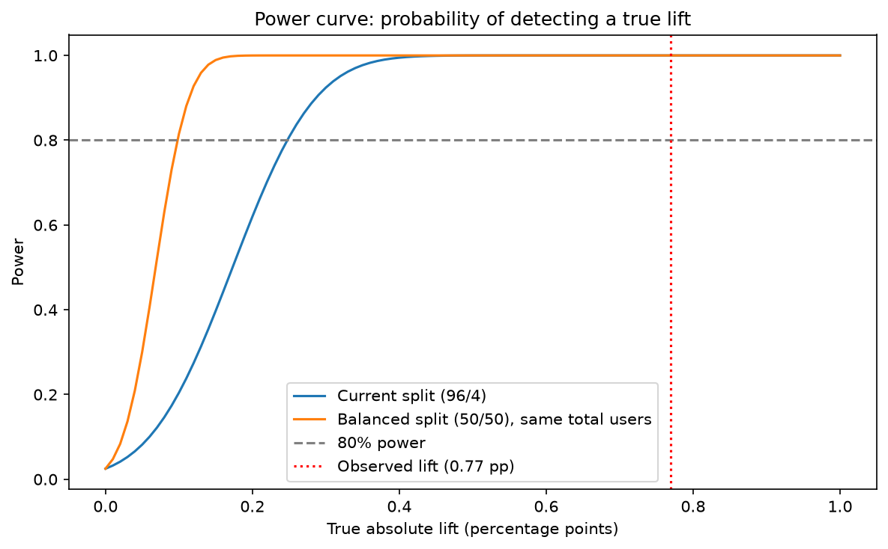
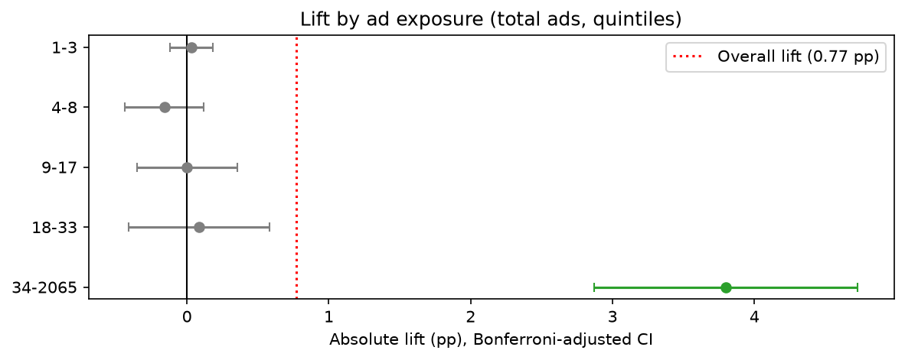

# Marketing A/B Test Analysis — Do Ads Actually Drive Conversions?

An end-to-end analysis of a marketing A/B test with 588,101 users, using
**SQL (DuckDB)** for data preparation and **Python** for hypothesis
testing, power analysis, and segment analysis.

## Key Findings
- **Ads work.** Users who saw product ads converted at **2.56%** vs
  **1.79%** for the control group: **+0.77 pp** (95% CI: 0.60–0.94 pp),
  ≈43% relative lift, p < 0.001.
- **In business terms:** ≈770 extra conversions per 100,000 users
  reached (plausible range: 600–940).
- **The test was well-powered:** the minimum detectable effect was
  0.25 pp, about 3× smaller than the observed lift.
- **The lift is concentrated in heavily exposed users.** Users who saw
  34+ ads showed a +3.80 pp lift; the other 80% of users showed almost
  no effect. Conversion also rose with exposure in the control group,
  pointing to user engagement as a confounder.
- **Recommendation:** continue the campaign, run a cost-benefit check
  before scaling, and test ad frequency in a follow-up experiment.
  → [Full business recommendation](reports/business_recommendation.md)

## Business Question
Does the ad campaign increase the conversion rate compared with a
control group? If so, by how much, and under which conditions is it
most effective?

## Dataset
[Marketing A/B Testing](https://www.kaggle.com/datasets/faviovaz/marketing-ab-testing)
(Kaggle). One row per user:

| Column | Description |
|---|---|
| `user id` | Unique user identifier |
| `test group` | `ad` (shown product ads) or `psa` (shown a public service announcement — the control) |
| `converted` | Whether the user made a purchase |
| `total ads` | Number of ads the user saw |
| `most ads day` | Day on which the user saw the most ads |
| `most ads hour` | Hour at which the user saw the most ads |

The control group sees a PSA in the same ad slots, so the test measures
the effect of product ads versus a placebo, not versus no ad at all.

## Approach
1. **Experiment brief** — hypotheses, α = 0.05, metrics, and decision
   rules written *before* the analysis
   ([experiment_brief.md](docs/experiment_brief.md)).
2. **Data quality checks (SQL)** — duplicates, cross-group users,
   missing values, value ranges, group allocation, and a sample ratio
   mismatch (SRM) check.
3. **Hypothesis testing** — two-proportion z-test, 95% confidence
   interval, absolute and relative lift. Implemented from scratch in
   `src/stats_utils.py` and validated against statsmodels.
4. **Power analysis** — minimum detectable effect and power curves for
   the actual 96/4 split vs. a hypothetical 50/50 split.
5. **Segment analysis** — lift by day, hour, and ad-exposure quintile,
   with Bonferroni correction within each family of tests (36 tests in
   total).
6. **Business recommendation** — results translated into decisions
   and next steps.

## Results

### Primary test
| Metric | Value |
|---|---|
| Conversion rate — ad | 2.555% (14,423 / 564,577) |
| Conversion rate — psa | 1.785% (420 / 23,524) |
| Absolute lift | +0.769 pp |
| 95% CI for the difference | [0.595 pp, 0.943 pp] |
| Relative lift | +43.1% |
| z statistic / p-value | 7.37 / 1.7 × 10⁻¹³ |

### Power analysis
The test could reliably detect lifts of 0.25 pp or more (80% power,
α = 0.05). A 50/50 split would have been ~2.5× more sensitive, but would
have cost roughly 2,000 conversions during the test.



### Segment analysis (exploratory)
- **Ad exposure:** the lift appears only in the top quintile
  (34+ ads: 9.83% vs 6.03%). Conversion rises sharply with exposure in
  both groups, so `total ads` largely reflects user engagement.
- **Day:** significant lift on Monday–Wednesday, but confidence
  intervals overlap across days.
- **Hour:** without correction, 7 hours would look significant; after
  Bonferroni, only 1 remains. No clear hour-of-day pattern.



Segment variables were measured during the experiment, so segment
differences are not causal.

## Repository Structure
```
├── data/                   # raw and processed data (not tracked; see below)
├── docs/
│   └── experiment_brief.md
├── notebooks/
│   ├── 01_data_check_sql.ipynb       # data quality, SRM, conversion by group
│   ├── 02_hypothesis_test.ipynb      # z-test, CI, lift, power analysis
│   └── 03_segment_analysis.ipynb     # segments with Bonferroni correction
├── reports/
│   ├── business_recommendation.md
│   └── figures/
├── sql/                    # all SQL queries (DuckDB)
├── src/
│   └── stats_utils.py      # z-test, CI, lift, MDE, power, segment analysis
├── requirements.txt
└── README.md
```

## How to Reproduce
```bash
git clone https://github.com/nabilakarimaazka/marketing-ab-test-analysis.git
cd marketing-ab-test-analysis
python -m venv .venv
source .venv/bin/activate          # Windows: .venv\Scripts\activate
pip install -r requirements.txt

# Download the dataset (requires a Kaggle API token)
kaggle datasets download -d faviovaz/marketing-ab-testing -p data/raw --unzip
```
Then run the notebooks in order (01 → 02 → 03).

## Tech Stack
Python · DuckDB (SQL) · pandas · NumPy · SciPy · statsmodels · Matplotlib · Jupyter

## Limitations
- No cost, revenue, or experiment-duration data; ROI is not estimated.
- Segment analysis is exploratory because segment variables are
  post-treatment.
- The planned allocation ratio is undocumented; the observed split is
  consistent with an assumed 96/4 design.

## Author
**Nabila Karima Azka** · [LinkedIn](https://www.linkedin.com/in/nabilakarima) · [GitHub](https://github.com/nabilakarimaazka)